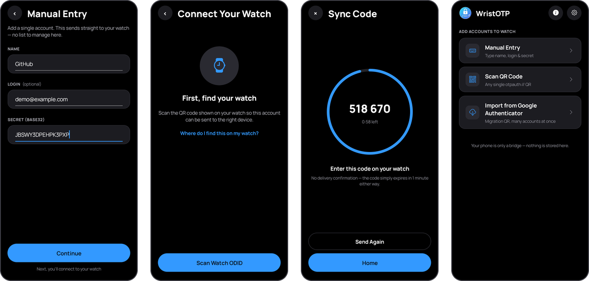
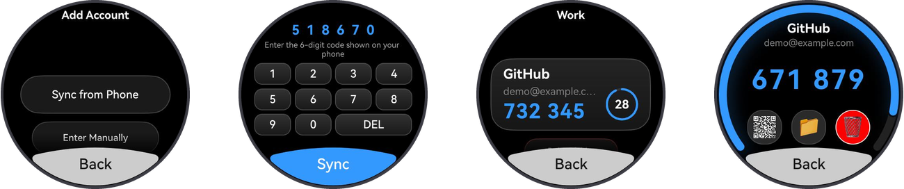

# WristOTP Relay

[English](#english) · [Русский](#русский)

The relay connects two apps: the **phone companion app**, where you add an
account and get a one-time sync code, and the **watch app**, where you type
that code and the account arrives — end-to-end encrypted through this relay.
<br>
Релей связывает два приложения: **приложение-компаньон на телефоне** (там
добавляется аккаунт и появляется код синхронизации) и **приложение на часах**
(там вводится этот код, и аккаунт приходит — со сквозным шифрованием через
этот релей).

### On the phone / На телефоне

<p align="center"></p>

1. Enter the account (or scan its QR) · Ввести аккаунт (или отсканировать его QR)
2. Scan the watch ID once · Один раз отсканировать ID часов
3. Get a one-time sync code · Получить одноразовый код синхронизации
4. Main screen: three ways to add accounts · Главный экран: три способа добавить аккаунт

### On the watch / На часах

<p align="center"></p>

1. Sync from Phone · Синхронизация с телефона
2. Type the same code · Ввести тот же код
3. Codes, grouped in folders · Коды, разложенные по папкам
4. Live code with a timer · Живой код с таймером

<sub>Screenshots use a demo account. / На скриншотах — демо-аккаунт.</sub>

## English

The server part of **WristOTP**, a TOTP authenticator for Huawei watches
(HarmonyOS). It is a tiny, purely **ephemeral relay** that hands an encrypted
account bundle from the phone app to the watch app.

- An entry lives in memory for **at most one minute** or until it is read
  once — whichever comes first. No user data is written to disk; there is no
  database, no user accounts, no backups. The only file the relay writes is
  one anonymous number: the all-time count of successful deliveries shown on
  the landing page.
- The server **never sees plaintext**. The phone encrypts the bundle with
  AES-256-GCM; the key and the entry ID (`LookupID`) are both derived with
  HKDF-SHA256 from the watch's device ID and a 6-digit code the user types
  into the watch. The server only stores an opaque blob under an opaque ID.

### API

| Method | Path | Description |
|---|---|---|
| `PUT` | `/api/v1/tokens/{id}` | Store `{ iv, authTag, ciphertext }` (Base64) for 1 minute. Bodies over 10 KB → `413`, invalid JSON → `400`. |
| `GET` | `/api/v1/tokens/{id}` | Return the entry and **delete it immediately** (one-time read; a repeat → `404`). Rate limit: 5 requests/min/IP (sliding window) → `429`. |
| `GET` | `/` | Public landing page with live, anonymous counters. |
| `GET` | `/api/v1/stats` | Aggregated counters only — no IDs, no payloads. |
| `GET` | `/api/v1/config` | Page settings (repository link, privacy contact). |
| `GET` | `/privacy` | Privacy policy (English and Russian). |
| `GET` | `/debug` | Diagnostics page — **Debug build only**; the code is not compiled into Release at all. Shows payload sizes, never contents. |

### Run locally

```
cd WristOTP.Server
dotnet run
```

Requires the .NET 10 SDK. The port is **8443**, set in `Program.cs`: the Debug
build listens on all interfaces (to test with real devices on your LAN), the
Release build on `127.0.0.1` only (put a TLS reverse proxy in front).

```
curl -X PUT http://localhost:8443/api/v1/tokens/abc123 \
  -H "Content-Type: application/json" \
  -d '{"iv":"aXY=","authTag":"dGFn","ciphertext":"Y2lwaGVy"}'

curl http://localhost:8443/api/v1/tokens/abc123
```

### Run your own relay

For maximum privacy you don't have to trust the public relay at all.

**On your own computer (home network):**

1. Install the .NET 10 SDK, clone this repository and run `dotnet run` in
   `WristOTP.Server/`. The Debug build listens on all interfaces, port 8443.
2. Find your computer's local IP address (e.g. `192.168.1.20`) and allow
   incoming connections on port 8443 in its firewall.
3. On the watch: **Settings → Relay server** → `http://192.168.1.20:8443` →
   *Test connection* → *Save*. In the phone app: **Settings** → the same address.
4. The watch, the phone and the computer must be on the same Wi-Fi network
   while you sync. Plain `http://` is fine here: the data is end-to-end
   encrypted anyway.

**On a server with a domain and HTTPS:** see [deploy/README.md](deploy/README.md)
(systemd unit, nginx example, one-command deploy script), then set
`https://your-domain` in both apps.

### Configuration

`appsettings.json` (or environment variables, e.g. `Links__ContactEmail`):

- `Links:GithubRepoUrl` — the repository link shown on the landing page
  (leave empty to hide it).
- `Links:ContactEmail` — privacy contact shown on `/privacy` (the privacy
  policy page app stores ask for). Empty → the repository link is shown.

If you run your own relay, review `wwwroot/privacy.html` so that it matches
how you operate it (logs, retention, hosting). The published policy says no
request log is kept — `deploy/nginx.conf.example` is configured that way.

### License

[GNU Affero General Public License v3.0](LICENSE) (AGPL-3.0). You may use,
study, modify and run the relay. If you run a modified version as a service
for other people, you must make your modified source code available to them
as well.

## Русский

Серверная часть **WristOTP** — TOTP-аутентификатора для часов Huawei
(HarmonyOS). Это маленький, полностью **эфемерный релей**: он передаёт
зашифрованный пакет аккаунтов из приложения на телефоне в приложение на часах.

- Запись живёт в памяти **не дольше минуты** или до первого чтения — что
  наступит раньше. Никакие данные пользователей на диск не пишутся; нет базы
  данных, учётных записей пользователей и бэкапов. Единственный файл, который
  пишет релей, — одно анонимное число: общее количество успешных доставок для
  стартовой страницы.
- Сервер **никогда не видит открытых данных**. Телефон шифрует пакет
  AES-256-GCM; и ключ, и идентификатор записи (`LookupID`) выводятся через
  HKDF-SHA256 из идентификатора часов и 6-значного кода, который
  пользователь вводит на часах. Сервер хранит лишь непрозрачный блоб под
  непрозрачным ID.

### API

| Метод | Путь | Описание |
|---|---|---|
| `PUT` | `/api/v1/tokens/{id}` | Сохранить `{ iv, authTag, ciphertext }` (Base64) на 1 минуту. Тело больше 10 КБ → `413`, некорректный JSON → `400`. |
| `GET` | `/api/v1/tokens/{id}` | Отдать запись и **сразу удалить** (одноразовое чтение; повтор → `404`). Лимит: 5 запросов/мин/IP (скользящее окно) → `429`. |
| `GET` | `/` | Публичная стартовая страница с живыми анонимными счётчиками. |
| `GET` | `/api/v1/stats` | Только агрегированные счётчики — без ID и содержимого. |
| `GET` | `/api/v1/config` | Настройки страницы (ссылка на репозиторий, контакт). |
| `GET` | `/privacy` | Политика конфиденциальности (английский и русский). |
| `GET` | `/debug` | Диагностика — **только Debug-сборка**; в Release этот код не компилируется вовсе. Показывает размеры пакетов, но не содержимое. |

### Запуск локально

```
cd WristOTP.Server
dotnet run
```

Нужен .NET 10 SDK. Порт **8443** задан в `Program.cs`: Debug-сборка слушает
все интерфейсы (чтобы тестировать с реальных устройств в локальной сети),
Release — только `127.0.0.1` (перед ним ставится reverse proxy с TLS).

### Свой релей

Для максимальной приватности публичному релею можно вообще не доверять.

**На своём компьютере (домашняя сеть):**

1. Установите .NET 10 SDK, склонируйте репозиторий и выполните `dotnet run`
   в папке `WristOTP.Server/`. Debug-сборка слушает все интерфейсы, порт 8443.
2. Узнайте локальный IP компьютера (например `192.168.1.20`) и разрешите в
   брандмауэре входящие подключения на порт 8443.
3. На часах: **Settings → Relay server** → `http://192.168.1.20:8443` →
   *Test connection* → *Save*. В приложении на телефоне: **Settings** → тот же
   адрес.
4. Во время синхронизации часы, телефон и компьютер должны быть в одной
   сети Wi-Fi. Обычный `http://` здесь допустим: данные и так зашифрованы
   сквозным шифрованием.

**На сервере с доменом и HTTPS:** см. [deploy/README.md](deploy/README.md)
(unit systemd, пример nginx, скрипт деплоя одной командой), затем укажите
`https://ваш-домен` в обоих приложениях.

### Настройки

`appsettings.json` (или переменные окружения, например `Links__ContactEmail`):

- `Links:GithubRepoUrl` — ссылка на репозиторий на стартовой странице
  (пустое значение скрывает её).
- `Links:ContactEmail` — контакт по вопросам конфиденциальности на
  `/privacy` (страница политики, которую требуют магазины приложений).
  Пусто → показывается ссылка на репозиторий.

Если вы разворачиваете свой релей, проверьте `wwwroot/privacy.html` — она
должна соответствовать тому, как работает ваш сервер (журналы, сроки
хранения, хостинг). В опубликованной политике сказано, что журнал запросов
не ведётся, — `deploy/nginx.conf.example` настроен именно так.


### Лицензия

[GNU Affero General Public License v3.0](LICENSE) (AGPL-3.0). Релей можно
использовать, изучать, изменять и запускать. Если вы запускаете изменённую
версию как сервис для других людей, вы обязаны открыть им и свой изменённый
исходный код.
